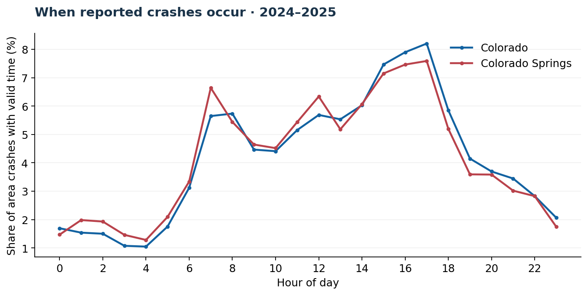
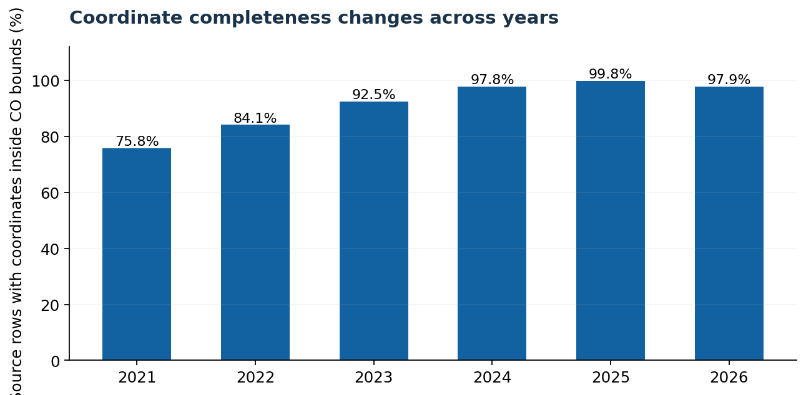

# Descriptive findings: CDOT crash listings, 2021–2026

**Scope.** This report was computed from six CDOT XLSX files supplied for the project. To compare complete calendar years, most findings below use **2021–2025 only**. The uploaded 2026 extract extends through **September 30, 2026** and is preliminary; it is deliberately excluded from full-year comparisons. Counts may be revised in later CDOT releases.

## 1. Size and geographic distribution

| Area | 2021–2025 crashes | 2021 | 2025 | 2021→2025 change |
|---|---:|---:|---:|---:|
| Colorado statewide | 492,312 | 97,788 | 95,696 | −2.1% |
| El Paso County | 51,205 | 11,000 | 9,940 | −9.6% |
| Colorado Springs (city designation) | 36,528 | 8,290 | 6,962 | −16.0% |

**Interpretation:** The number of reported crashes in the *listed records* was lower in 2025 than in 2021, especially in the Colorado Springs-labeled subset. This does **not** by itself prove roads became safer: driving volume, reporting practices, location labeling, and data updates may have changed.

## 2. Crash outcomes

| Area (2021–2025) | Fatal crashes | Injury crashes (no reported fatality) | Share of crashes with injury or fatality |
|---|---:|---:|---:|
| Colorado | 3,303 | 128,252 | 26.72% |
| El Paso County | 372 | 16,943 | 33.82% |
| Colorado Springs | 241 | 12,328 | 34.41% |

A **fatal crash** has at least one reported death; an **injury crash** has at least one reported injury but no reported death. These columns are **crash counts, not counts of affected people**. The differences between areas do not establish relative travel risk or injury severity: they may reflect road types and reporting/coverage differences.

## 3. Hour-of-day data has a significant unresolved anomaly

The local time-of-day field appears internally inconsistent across some years. The percentage of Colorado Springs crash times recorded from 12:00–23:59 is:

| Year | Colorado Springs after noon | El Paso County after noon | Statewide after noon |
|---|---:|---:|---:|
| 2021 | 27.9% | 35.2% | 60.0% |
| 2022 | 9.3% | 19.9% | 56.1% |
| 2023 | 8.6% | 22.3% | 56.6% |
| 2024 | 53.7% | 56.7% | 61.9% |
| 2025 | 65.3% | 64.6% | 63.9% |
| 2026 (partial) | 64.5% | 63.9% | 63.7% |

The striking 2022–2023 pattern is **not reliable evidence that morning travel was particularly dangerous**. It suggests a possible time-field source/coding/formatting problem that needs verification with CDOT or original reporting metadata. We have **not automatically corrected it**, because the correct AM/PM cannot be deduced from this distribution alone.

**For the local hour-of-day visualization, the dashboard deliberately excludes 2021–2023.** Looking at 2024–2025 only, 5 p.m. is the most frequently recorded hour for both Colorado Springs and the state as a whole. This remains a count, not a risk estimate.

## 4. Common crash type

The most common named crash type in the 2021–2025 listings was **Rear-End**:

- Colorado statewide: **139,194** recorded rear-end crashes.
- Colorado Springs: **11,111** rear-end crashes, approximately **30.4%** of the 36,528 city-designated crash records.

This suggests rear-end collisions are a useful first category for further study, but interpreting causes would require detailed contributing-factor fields, collision diagrams, and exposure information.

## 5. Coordinates became much more complete over time

- **2021:** 74,155 of 97,788 source rows had coordinates within the broad Colorado validity envelope, roughly **75.8%**.
- **2025:** 95,460 of 95,696 source rows did, roughly **99.8%**.

These data-quality differences can create **apparent geographic trends even if underlying crash risk has not changed**. Maps should always state their coordinate coverage. Geocoding errors remain possible even for rows with valid-looking coordinates.

## 6. The school-zone field is not a school safety census

The 2021–2025 records have just **1 Colorado Springs-designated row** and **18 El Paso County rows** with the selected `School Zone` flag set. These are reported source flags, not total crashes within walking distance of schools.

It would be a serious mistake to conclude that only one crash occurred near a school in Colorado Springs. A true **school-adjacent crash study** would need verified school sites, time/day constraints, GIS buffers, and additional field definitions. Sidewalk hazards need separate observations or infrastructure datasets altogether.

## 7. 2026 must be treated as incomplete

The 2026 file contains **69,531** rows through September 30, 2026. The source status column includes **8,725 `New`** and **94 `In Progress`** records, alongside coded rows. These statuses reinforce why it should not be used as a complete-year figure or presented as final crash statistics.

## Research question to extend this project

> Which routes used by students near schools show both a history of reported vehicle crashes **and** independently observed pedestrian-infrastructure problems?

That question can be examined responsibly by collecting and documenting new municipal sidewalk/crosswalk observations, obtaining school locations, and checking traffic/pedestrian exposure. The CDOT data alone cannot answer it.

## Sources and limitations

- [CDOT Crash Data / Statewide Crash Data Listing (2021–2026)](https://www.codot.gov/safety/traffic-safety/data-analysis/crash-data)
- Primary observations: six supplied Excel downloads, analyzed with `src/ingest.py`.
- These figures reflect the snapshot of files provided in October 2026 and may change when CDOT updates them.
- The source warns that 2026 is preliminary, 2021–2026 may be revised, and the listings are protected under 23 U.S.C. § 407.
- Results are independent and descriptive, **not** official CDOT numbers or an engineering assessment.
