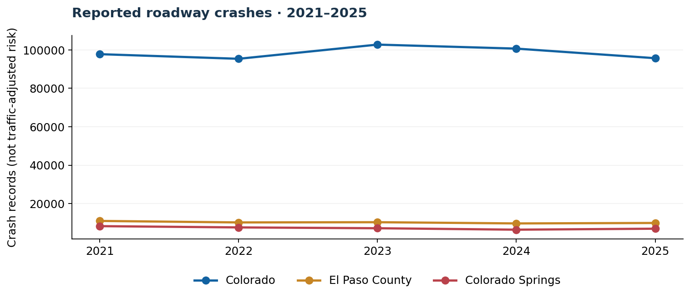

# Colorado Crash Explorer

**What can five years of Colorado traffic crash records tell us about our communities?**

An open, reproducible Python data-storytelling project exploring **reported roadway crashes in Colorado**, with a close look at **Colorado Springs and El Paso County**. The repository combines a streaming Excel-to-CSV ETL pipeline, compact aggregated datasets, an interactive Streamlit/Plotly dashboard, tests, and a limitations-first research report.



> **The motivation**: Questions about walking around schools and neighborhood safety deserve evidence. These CDOT records are a useful starting point for *road-crash* safety. **They do not capture ordinary sidewalk falls, broken sidewalks, or trips that do not involve reportable crashes.** Connecting sidewalk observations to roadway crashes would require other datasets and field research.

## What this project includes

- **561,843** annual CDOT crash rows ingested across 2021–2026.
- **2021–2025** as the default comparable full-year window; **2026 is preliminary and partial** (data currently through September 30, 2026).
- Explore reports statewide or filtered to **El Paso County** and **Colorado Springs**.
- Descriptive breakdowns by year, time of day, month, weekday, crash outcome, weather, lighting, road surface, crash type, school-zone flag, and selected non-motorist indicators.
- **El Paso map** based on approximate 0.01° spatial grid cells, not geocoded exact crash/roadway risk scores.
- A visible **data-quality audit**, especially date validity, available coordinates, and coded-versus-new statuses.
- An *optional* AI feature that receives only aggregate numbers for drafting a cautious, editable plain-language interpretation. The dashboard works without an API key.
- Tiny, GitHub-friendly **derived data** (< 2MB) and a reproducible transformer for the original Excel files.


## Quick start

Requires **Python 3.10+** and internet during installation. Clone/download the repository:

```bash
python -m venv .venv
# macOS/Linux
source .venv/bin/activate
# Windows PowerShell: .venv\Scripts\Activate.ps1
pip install -r requirements.txt
streamlit run app.py
```

Open the local URL displayed by Streamlit. **The processed CSV files are included**, so you can explore the dashboard without downloading the original large XLSX files.

### To reproduce the data from source

1. Download annual "Statewide Crash Data Listing" `.xlsx` files for 2021–2026 from the [CDOT Crash Data page](https://www.codot.gov/safety/traffic-safety/data-analysis/crash-data).
2. Place them in `raw_data/` (excluded from Git). Preserve names containing `CDOTRM_CD_Crash_Listing` and the year.
3. Run:

```bash
python -m src.ingest --input-dir raw_data --output-dir data/processed
python -m unittest discover -s tests -v
python scripts/create_charts.py
streamlit run app.py
```

**Note:** CDOT notes that 2026 data is preliminary/rough and that 2021–2026 files can be revised. Re-downloading may change the numbers in this repository. The code is licensed MIT; that does *not* license the underlying CDOT data. Follow the source's attribution and use notices.

## Interactive pages

| Page | Questions to explore |
|---|---|
| Overview | How many crashes were reported each year? What share involved reported injuries or deaths? Which counties have the largest counts? |
| When | Which hours, months, and weekdays have the most reported crashes? |
| Conditions & crash types | What weather, lighting, road-surface, and crash-type labels are most common? How many crashes have a school-zone flag? |
| El Paso map | Where do location-coded reports cluster in approximate 1-km cells? |
| Data quality & methods | What is incomplete or uncertain? How were counts computed? |

## Findings to start with

See [INSIGHTS.md](INSIGHTS.md) for numbers calculated from the attached extracts, five descriptive comparisons, and the specific limitations that matter. Use these as *research questions*, not causal conclusions.

## Repository structure

```
colorado-crash-explorer/
├── app.py                        # Interactive Streamlit dashboard
├── src/
│   ├── ingest.py                 # Streaming CDOT XLSX extraction and aggregation
│   ├── metrics.py                # Independently testable metric definitions
│   └── ai_narrative.py           # Optional opt-in aggregate-only AI summary
├── data/processed/              # Compact derived CSV tables + JSON summary
├── scripts/quick_insights.py     # Beginner-friendly descriptive analysis example
├── scripts/create_charts.py      # Reproduce publication-ready summary charts
├── scripts/build_pages.py        # Rebuild the GitHub Pages preview
├── docs/index.html               # Interactive no-server preview
├── assets/                       # Static PNG charts for GitHub / presentations
├── tests/test_metrics.py         # Unit tests for date, severity and coordinates
├── INSIGHTS.md                   # Descriptive findings with caveats
├── DATA_DICTIONARY.md            # Field selection and dataset interpretation
├── GETTING_STARTED_WINDOWS.md   # Detailed beginner setup, code, and publishing walkthrough
├── CONTRIBUTING.md              # Extensible research roadmap
└── requirements.txt
```

## Key metric definitions

- **Reported crash** = a retained row in the annual source listing; duplicate source IDs *within a year* are removed if present.
- **Fatal crash** = `Number Killed > 0` (count of *crashes*, not deaths).
- **Injury crash** = `Number Killed = 0 AND Number Injured > 0` (count of *crashes*, not injured people).
- **No injury reported** = both fields equal zero. Missing or invalid outcome counts are kept separate.
- **Crashes involving injury or fatality (%)** = `(fatal crash count + injury crash count) / all crash records`, not a population-based risk rate.
- **Date** = numeric Excel date serial; the annual table groups by **source file year**. Month/day charts include only dates matching that year.
- **School zone** = administrative `School Zone` flag, *not* proof a child was involved or that the event happened during school hours.
- **Non-motorist category** = an exploratory classification based only on `TU-1 NM Type` and `TU-2 NM Type`. For complete pedestrian/cyclist characterization, validate all available non-motorist columns and the CDOT data dictionary.

## Responsible interpretation

1. **Exposure bias:** A busy highway may have more total crashes because more vehicles travel it. To calculate *risk*, add traffic counts, road miles, or pedestrian footfall.
2. **Location quality:** Crash coordinates are missing in some years, and the share with valid coordinates changes substantially. Never compare mapped hotspots across years without accounting for geocoding coverage.
3. **Time-of-day anomaly:** El Paso County / Colorado Springs hours for 2021–2023 have an unexplained before-noon concentration. Local hour charts exclude those years until verified.
4. **Recent data:** 2026 is incomplete, provisional, and has a substantial share of records with `New` status; do not compare it against 12-month totals as if it were a full year.
5. **Geographic accuracy:** Spatial grid cells are rough clusters and may span multiple streets. Always verify candidate intersections with street-level evidence.
6. **No causal claim:** Lighting or weather bars count *crashes under those conditions*, not how much those conditions cause crashes. Normal travel patterns are unobserved.
7. **Scope:** CDOT motor-vehicle crash data cannot establish the frequency of non-crash sidewalk falls. Street audits or municipal infrastructure reports are needed for that question.

## Publish an interactive GitHub Pages preview (free)

This repository also includes a ready-made **`docs/index.html`** with interactive charts that work on GitHub Pages without running Streamlit or supplying an API key. To enable it:

1. Upload the project to a public GitHub repository.
2. Repository **Settings → Pages → Build and deployment → Deploy from a branch**.
3. Select branch **main**, folder **/docs**, and click **Save**.
4. Your interactive preview will appear at `https://YOUR-USERNAME.github.io/YOUR-REPO/` once Pages finishes deploying.

To regenerate the static preview after refreshing the CSVs:

```bash
python scripts/build_pages.py
```

The preview loads Plotly from a public CDN, so its charts need an internet connection. The included `app.py` is the more complete dashboard, including El Paso spatial bins and optional AI summaries.

## How to expand it

The best next step is adding a **school walkability audit** in Colorado Springs: verified school locations, crosswalk quality, sidewalk conditions and responsible street-level field observations. Then combine those new data with CDOT crash records while keeping the two evidence types clearly separate. See [CONTRIBUTING.md](CONTRIBUTING.md) for a scoped roadmap.

## Source and attribution

Original annual tables and [2021–2026 data dictionary](https://www.codot.gov/safety/traffic-safety/data-analysis/crash-data): **Colorado Department of Transportation (CDOT), Statewide Crash Data Listings, 2021–2026**, accessed October 2026. CDOT maintains that all its crash listings, reports, and dashboards are protected under 23 U.S.C. § 407. This independent educational project is neither endorsed by nor affiliated with CDOT. It reports descriptive aggregates and should not be used alone for safety or engineering decisions.
